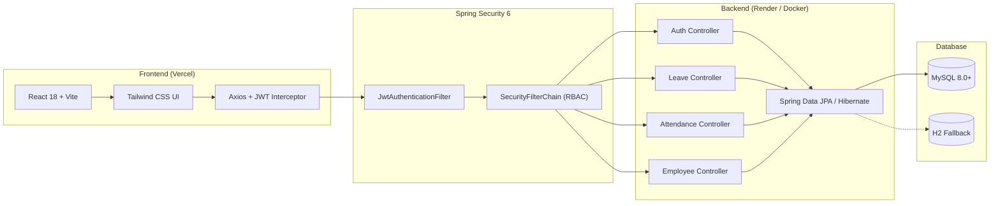

# 🌐 WorkForce 360 — Production-Ready Employee Leave Management & Attendance Tracker

[](https://openjdk.org/)
[](https://spring.io/projects/spring-boot)
[](https://spring.io/projects/spring-security)
[](https://hibernate.org/)
[](https://www.mysql.com/)
[](https://react.dev/)
[](https://tailwindcss.com/)
[](https://www.docker.com/)

---

## 📌 Executive Summary

**WorkForce 360** is a full-stack, enterprise-grade Employee Leave Management and Attendance Tracking system tailored specifically to modern Java & React production architectures.

It features:
- **Role-Based Access Control (RBAC)**: Distinct permissions for `ROLE_EMPLOYEE` and `ROLE_MANAGER`.
- **Stateless Authentication**: High-security JSON Web Tokens (JJWT 0.12.x) with BCrypt-hashed credentials.
- **Automated Leave Balance Accrual & Deduction**: Deducts leave days upon Manager approval; rejects with zero balance loss; validates overlap, future dates, and available quotas.
- **Duplicate-Proof Daily Attendance**: Unique database constraints prevent multiple check-ins on the same day (`uk_employee_date`).
- **Dual-Database Support**: Connects out of the box to **MySQL** (MySQL Workbench compatible) and includes an **H2 In-Memory fallback profile** for zero-setup local runs.
- **Cloud Deployment Ready**: Optimized with `Dockerfile` for **Render** and CORS-configured for **Vercel**.

---

## 🏗️ Architecture & Tech Stack



---

## 📂 Project Structure

```
WorkForce 360/
├── backend/
│   ├── Dockerfile                           # Multi-stage production container build
│   ├── pom.xml                              # Maven build file (Spring Boot 3.3.4, Java 17)
│   ├── src/
│   │   ├── main/
│   │   │   ├── java/com/workforce360/
│   │   │   │   ├── WorkforceApplication.java # Spring Boot entry + sample data seed
│   │   │   │   ├── config/                  # SecurityConfig, JwtAuthenticationFilter, JwtUtil, CorsConfig
│   │   │   │   ├── controller/              # AuthController, LeaveController, AttendanceController, EmployeeController
│   │   │   │   ├── dto/                     # LoginRequest, RegisterRequest, AuthResponse, LeaveApplyDTO, etc.
│   │   │   │   ├── entity/                  # Employee, LeaveRequest, Attendance + Enums
│   │   │   │   ├── exception/               # GlobalExceptionHandler, ResourceNotFoundException, etc.
│   │   │   │   ├── repository/             # EmployeeRepository, LeaveRepository, AttendanceRepository
│   │   │   │   └── service/                # AuthService, LeaveService, AttendanceService, CustomUserDetailsService
│   │   │   └── resources/
│   │   │       ├── application.properties   # Main configuration & dynamic port
│   │   │       ├── application-mysql.properties # MySQL Workbench / Cloud config
│   │   │       └── application-h2.properties    # Instant H2 local profile
├── frontend/
│   ├── index.html                           # Modern HTML5 shell with Plus Jakarta Sans
│   ├── package.json                         # React 18, Vite, Tailwind CSS, Lucide Icons, Axios
│   ├── tailwind.config.js                   # Extended brand palette
│   ├── vite.config.js                       # Fast Vite bundler config
│   ├── vercel.json                          # SPA client-side routing config for Vercel
│   ├── .env                                 # Local API target: http://localhost:8080
│   └── src/
│       ├── api/axios.js                     # Global Axios client with JWT interceptor
│       ├── context/AuthContext.jsx          # Auth state (token, user, role, balance)
│       ├── components/                      # Navbar, StatsCard, StatusBadge
│       ├── pages/                           # AuthPage, EmployeeDashboard, ManagerDashboard
│       ├── App.jsx                          # Role-based route rendering
│       └── main.jsx                         # Application entry
└── README.md                                # Comprehensive documentation & Postman guide
```

---

## 🔑 Pre-Seeded Sample Accounts

When running the application for the first time, sample accounts are automatically seeded into the database:

| Role | Email | Password | Available Leaves | Department |
| :--- | :--- | :--- | :---: | :--- |
| **Manager** | `manager@workforce360.com` | `Manager@123` | 25 Days | Operations & HR |
| **Employee** | `alex.rivera@workforce360.com` | `Employee@123` | 18 Days | Engineering |
| **Employee** | `priya.sharma@workforce360.com` | `Employee@123` | 16 Days | Product Design |
| **Employee** | `michael.chang@workforce360.com` | `Employee@123` | 14 Days | Quality Assurance |

> 💡 **Tip**: You can also register brand-new Employees or Managers directly from the frontend UI!

---

## 🚀 Running Locally

### Step 1: Clone or Open the Project
Open terminal in the project root:
```bash
cd "WorkForce 360"
```

### Step 2: Run the Backend (Spring Boot)

#### Option A: Run with PostgreSQL (Recommended)
1. Ensure your local PostgreSQL service is running on port `5432` (or use cloud PostgreSQL like Render, Supabase, Neon).
2. Create a database named `workforce360` in pgAdmin or psql:
   ```sql
   CREATE DATABASE workforce360;
   ```
3. Set your credentials in `backend/src/main/resources/application-postgres.properties` (or set environment variables `DB_USERNAME`, `DB_PASSWORD`, `DB_HOST`, `DB_PORT`, `DB_NAME`).
4. Run:
   ```bash
   cd backend
   .\mvnw spring-boot:run
   ```

#### Option B: Run with MySQL (MySQL Workbench)
1. Ensure your local MySQL server is running (default port `3306`).
2. Run:
   ```bash
   cd backend
   .\mvnw spring-boot:run "-Dspring-boot.run.profiles=mysql"
   ```

#### Option C: Run with H2 In-Memory DB (Zero Setup, Instant Test)
```bash
cd backend
.\mvnw spring-boot:run "-Dspring-boot.run.profiles=h2"
```

### Step 3: Run the Frontend (React + Vite)
In a separate terminal:
```bash
cd frontend
npm install
npm run dev
```
Open **`http://localhost:5173`** in your browser.

---

## 🧪 Postman & cURL API Testing Guide

### 1. Register an Employee
```bash
curl -X POST http://localhost:8080/api/auth/register \
  -H "Content-Type: application/json" \
  -d '{
    "fullName": "David Miller",
    "email": "david.miller@workforce360.com",
    "password": "Password@123",
    "role": "EMPLOYEE",
    "department": "Engineering",
    "designation": "Backend Developer"
  }'
```

### 2. Login to Obtain JWT Token
```bash
curl -X POST http://localhost:8080/api/auth/login \
  -H "Content-Type: application/json" \
  -d '{
    "email": "david.miller@workforce360.com",
    "password": "Password@123"
  }'
```
*Response contains `token`. Export it:*
```bash
export TOKEN="<copied_jwt_token>"
```

### 3. Mark Attendance (Daily Check-in)
```bash
curl -X POST http://localhost:8080/api/attendance/mark \
  -H "Authorization: Bearer $TOKEN" \
  -H "Content-Type: application/json" \
  -d '{
    "status": "PRESENT"
  }'
```

### 4. Apply for Leave
```bash
curl -X POST http://localhost:8080/api/leaves/apply \
  -H "Authorization: Bearer $TOKEN" \
  -H "Content-Type: application/json" \
  -d '{
    "leaveType": "CASUAL",
    "startDate": "2026-11-20",
    "endDate": "2026-11-22",
    "reason": "Attending family wedding"
  }'
```

### 5. Manager: View Pending Leaves
*Login as `manager@workforce360.com` and pass Manager JWT:*
```bash
curl -X GET http://localhost:8080/api/leaves/pending \
  -H "Authorization: Bearer $MANAGER_TOKEN"
```

### 6. Manager: Approve Leave (Deducts Balance)
```bash
curl -X PUT http://localhost:8080/api/leaves/1/approve \
  -H "Authorization: Bearer $MANAGER_TOKEN"
```

### 7. Manager: Reject Leave (No Deduction)
```bash
curl -X PUT http://localhost:8080/api/leaves/1/reject \
  -H "Authorization: Bearer $MANAGER_TOKEN"
```

### 8. Manager: List All Employees & Balances
```bash
curl -X GET http://localhost:8080/api/employees \
  -H "Authorization: Bearer $MANAGER_TOKEN"
```

### 9. Manager: View Team Attendance (Filtered by Date)
```bash
curl -X GET "http://localhost:8080/api/attendance/all?date=2026-11-12" \
  -H "Authorization: Bearer $MANAGER_TOKEN"
```

---

## 🐳 Docker & Cloud Deployment

### Backend Deployment (Render)
1. In the **Render Dashboard**, select **New + Web Service**.
2. Connect your Git repository and set Root Directory to `backend/`.
3. Choose **Docker** as the Runtime (it will automatically use `backend/Dockerfile`).
4. Set Environment Variables:
   - `SPRING_PROFILES_ACTIVE`: `mysql`
   - `DB_URL`: `jdbc:mysql://<your-render-mysql-host>:<port>/<dbname>?useSSL=false`
   - `DB_USERNAME`: `<db_user>`
   - `DB_PASSWORD`: `<db_password>`
   - `JWT_SECRET`: `<secure-random-64-character-string>`
   - `CORS_ALLOWED_ORIGINS`: `https://<your-frontend>.vercel.app`

### Frontend Deployment (Vercel)
1. In the **Vercel Dashboard**, import your Git repository.
2. Set Root Directory to `frontend`.
3. Framework Preset: **Vite**.
4. Configure Environment Variable:
   - `VITE_API_BASE_URL`: `https://<your-backend-service>.onrender.com`
5. Click **Deploy**.

---

## 🛡️ License
This project is open-source and distributed under the **MIT License**.

